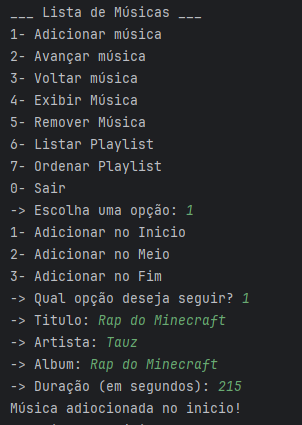
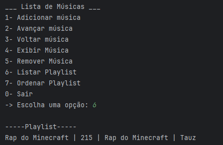
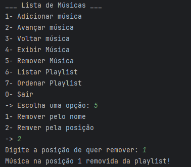

Aluno: Vinicios Magnus de Matos

## Introdução

A implementação de estruturas de dados manualmente é importante para entendermos como realmente funciona a alocação e manipulação de memória que nossos sistemas usam. Assim podemos controlar o uso de recursos e definir qual estrutura mantém o melhor desempenho para nossa aplicação.

## Implementação

- Estrutura do nó: Cada nó é instanciado como um objeto que armazena os atributos Titulo, Autor, Album e Duração, além de armazenar o próximo nó e também o último.
- Casos Críticos:
  - Remoção em lista vazia: O método para remover sempre valida se a lista possui objetos para poder prosseguir.
  - Atualização de ponteiros (inicio/fim): Quando inserimos ou removemos nas pontas, os atributos primeiraMusica e ultimaMusica são atualizados e as conexões são removidas ou adicionadas caso neessário.

## Execução
Adicionar

Exibir
  

Remover

## Conclusão

A principal dificuldade foi adaptar o Bubble Sort para ordenar os objetos. Porque a estrutura básica é bastante confusa e a adaptação para este projeto tornou ela maior do que eu esperava.  
Mesmo com as dificuldades e com o tamanho do sistema, deu para entender como funciona uma lista duplamente ligada e que em um sistema real, podemos facilmente nos deparar com esta estruturação.